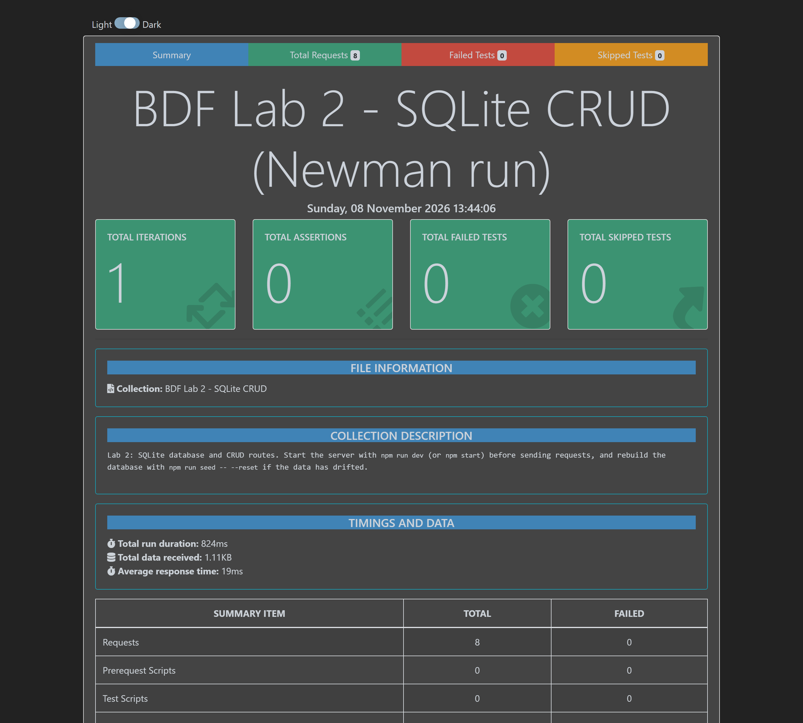
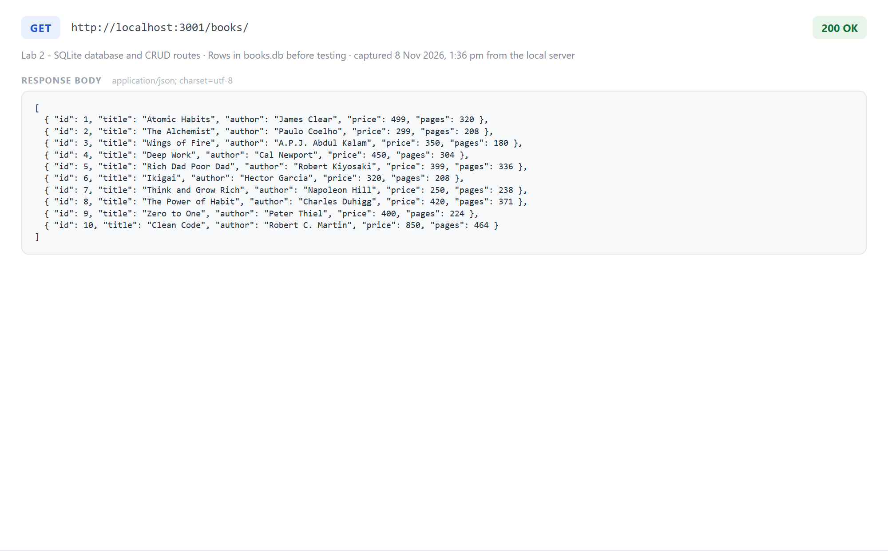
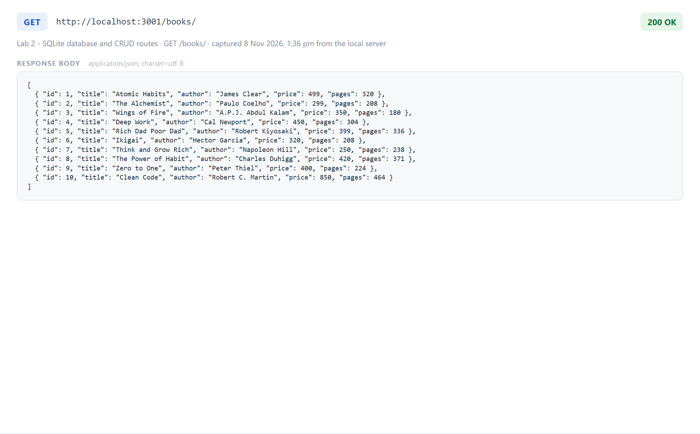
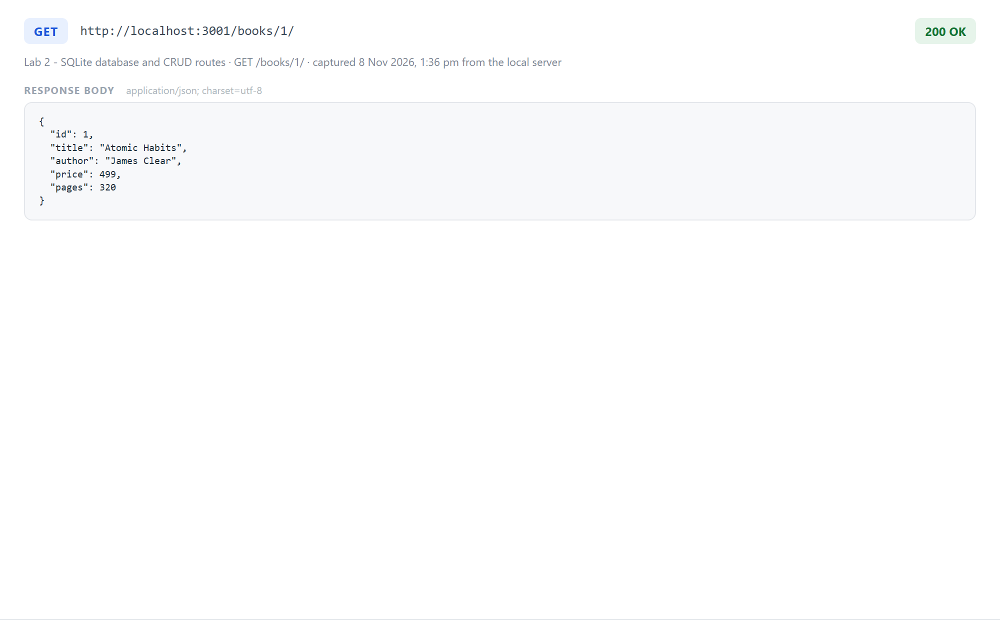
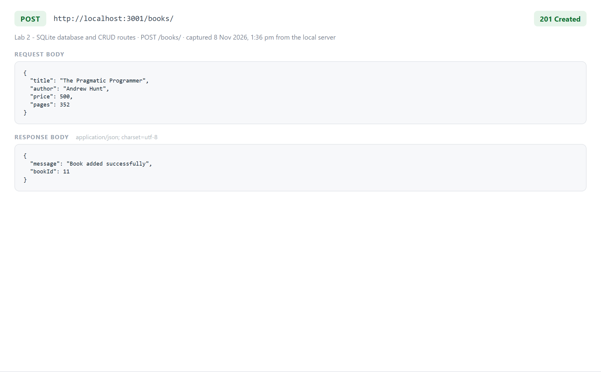
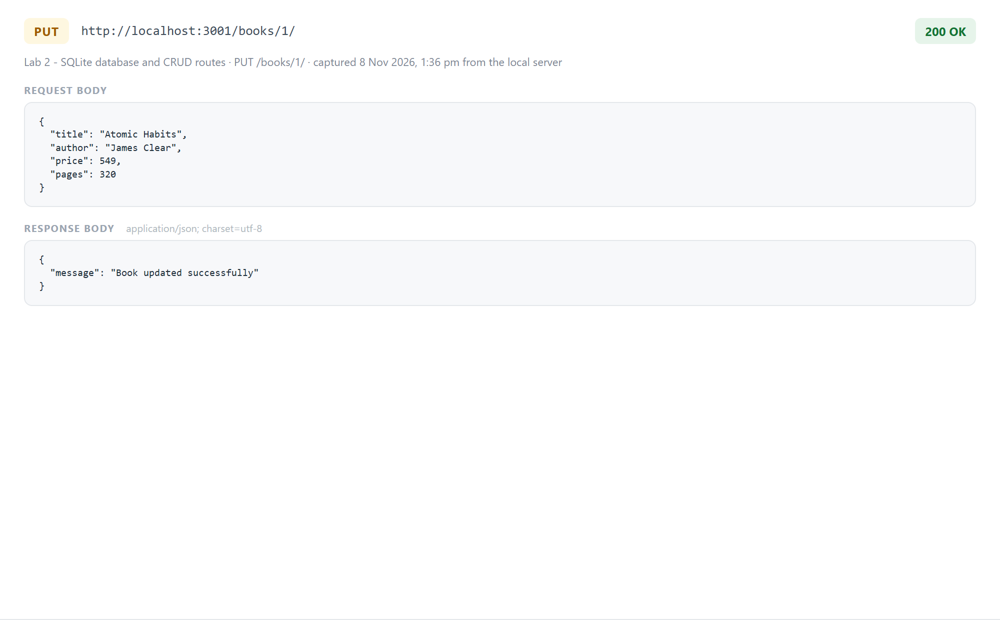
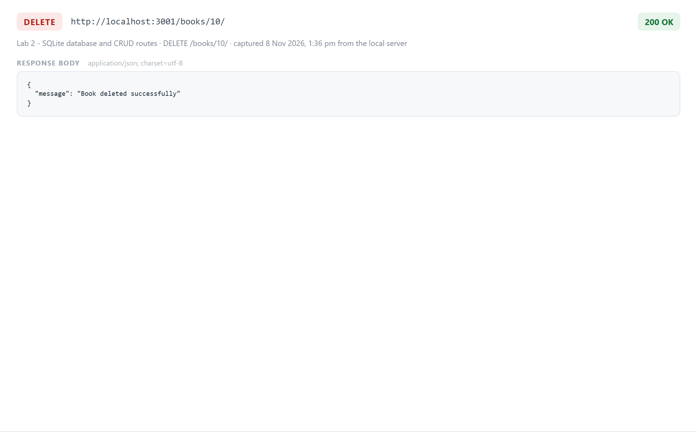
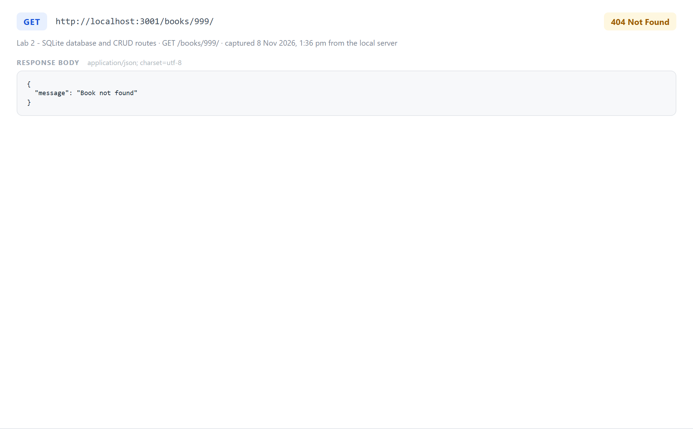
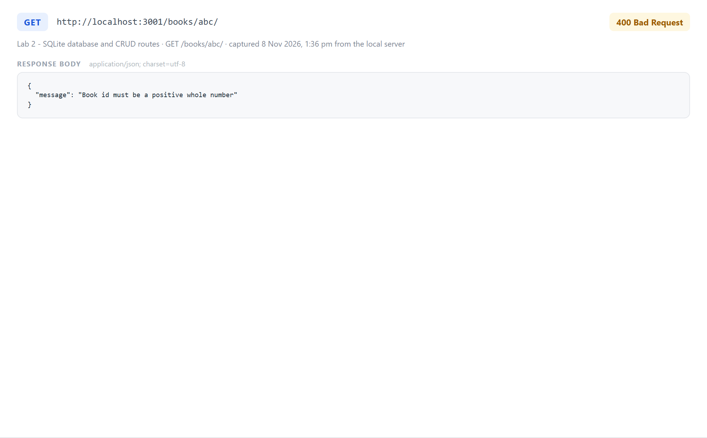
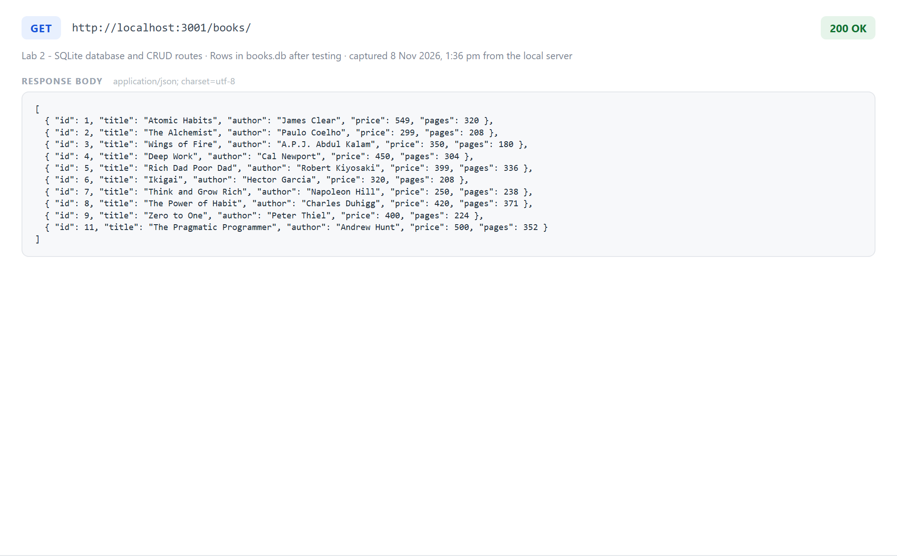

# Lab 2: SQLite database and CRUD routes

**Resham Karthik** · Registration number **252U1R7085** · Section **CSE FSD 2B 309**

Course: Backend Development Fundamentals — Year II Term II — Aurora
Faculty: Joel Prashanth D

> When the project is deployed to Vercel, the database is copied to `/tmp`, the only writable folder there. Create, update and delete work on the live link, but the data returns to the 10 starting rows whenever the instance restarts. Locally, changes are kept in `books.db`.

## Objective

Connect an Express server to a SQLite database and expose create, read, update and delete operations over HTTP, so the `book` table actually changes after POST, PUT and DELETE.

## Technologies used

- Node.js (v18 or later)
- Express.js 4
- SQLite (`sqlite` and `sqlite3` packages)
- nodemon (development only)
- Postman
- SQLite command-line shell
- VS Code

## Project structure

```text
lab-02/
├── api/
│   └── index.js            # Vercel entry point (imports the Express app)
├── screenshots/
│   ├── db-before.png
│   ├── get-all.png
│   ├── get-one.png
│   ├── post.png
│   ├── put.png
│   ├── delete.png
│   ├── error-400.png
│   ├── error-404.png
│   ├── db-after.png
│   └── postman-run.png
├── .gitignore
├── books.db                # SQLite database file (10 starting rows)
├── init.sql                # table definition and the 10 rows
├── seed.js                 # rebuilds books.db from init.sql
├── package.json
├── package-lock.json
├── postman_collection.json # the 8 requests used for testing
├── server.js               # Express server with the CRUD routes
├── vercel.json             # sends every request to api/index.js
└── README.md
```

## How to run

```bash
npm install
npm run dev
```

`npm run dev` starts the server with nodemon, so it restarts on every change. The terminal prints:

```text
Server running on port 3000
```

Open `http://localhost:3000/books/`. Use `npm start` instead of `npm run dev` to run it with plain Node.

### Database

`books.db` is committed, so the project works as soon as it is cloned. To rebuild it from scratch:

```bash
sqlite3 books.db < init.sql
```

or, without the SQLite CLI installed:

```bash
npm run seed
npm run seed -- --reset     # drop the table and re-insert the 10 rows
```

To inspect the table:

```text
sqlite3 books.db
.headers on
.mode column
SELECT * FROM book;
```

### Environment variables

| Variable | Required | Description |
|---|---|---|
| `PORT` | No | Port the server listens on. Falls back to `3000` when it is not set. |

No database password, API key or `.env` file is used, so there is nothing to keep secret. `.env` files are ignored by `.gitignore` in case one is added later.

## Endpoints

| Method | Path | Description | Success |
|---|---|---|---|
| GET | `/books/` | Returns every book in the table. | 200 |
| GET | `/books/:bookId/` | Returns the book with that id. | 200 |
| POST | `/books/` | Adds a book from the JSON body. | 201 |
| PUT | `/books/:bookId/` | Replaces every field of an existing book. | 200 |
| DELETE | `/books/:bookId/` | Deletes the book with that id. | 200 |

Request body for POST and PUT:

```json
{
  "title": "The Pragmatic Programmer",
  "author": "Andrew Hunt",
  "price": 500,
  "pages": 352
}
```

Every response — success or failure — uses the same shape:

```json
{ "message": "..." }
```

Error responses:

| Case | Status | Message |
|---|---|---|
| `bookId` is not a positive whole number | 400 | `Book id must be a positive whole number` |
| `title` missing or empty | 400 | `title is required` |
| `author` missing or empty | 400 | `author is required` |
| `price` is not a whole number, or is negative | 400 | `price must be a non-negative whole number` |
| `pages` is not a whole number, or is zero/negative | 400 | `pages must be a positive whole number` |
| The body is not valid JSON | 400 | `Request body must be valid JSON` |
| No book exists with that id | 404 | `Book not found` |
| Unknown route | 404 | `Route not found` |

Every query that uses input from the request passes it as a `?` placeholder:

```js
await request.db.get("SELECT * FROM book WHERE id = ?;", [bookId]);
```

The connection is opened once when the module loads, and each request awaits that open promise before querying. Without the `await`, a cold start can run a handler before `db` exists.

## Testing

All eight requests are in `postman_collection.json`: import it into Postman and press Send on each one. The collection variable `baseUrl` is `http://localhost:3000`.

| # | Request | Status observed | Database effect |
|---|---|---|---|
| 01 | `GET /books/` | 200 | none |
| 02 | `GET /books/1/` | 200 | none |
| 03 | `POST /books/` | 201 | new row added, id 11 |
| 04 | `PUT /books/1/` | 200 | row 1 updated |
| 05 | `DELETE /books/10/` | 200 | row 10 removed |
| 06 | `GET /books/999/` | 404 | none |
| 07 | `GET /books/abc/` | 400 | none |
| 08 | `GET /unknown` | 404 | none |

The collection was also executed end to end with Postman's Newman runner: 8 requests, 0 failed.



## Screenshots

Every capture below is a real response from the server running on `http://localhost:3001`.

### Database before testing

The 10 starting rows, read back through `GET /books/`.



### GET /books/ — all books



### GET /books/1/ — one book



### POST /books/ — add a book

Adds a book and returns 201 with the new id.



### PUT /books/1/ — update a book

Replaces the fields of book 1 and returns 200.



### DELETE /books/10/ — delete a book

Removes row 10 and returns 200.



### Error case — unknown book id

`GET /books/999/` returns 404 because no such row exists.



### Error case — invalid book id

`GET /books/abc/` returns 400 because the id is not a positive whole number.



### Database after testing

Row 1 is updated, row 10 is gone, and the book added with POST is row 11.



## Rules followed

- `node_modules` is not committed; each folder has its own `.gitignore`.
- No `.env` file or secret value is committed.
- Every route returns the correct status code.
- All database queries use parameterised statements, never string concatenation of user input.
